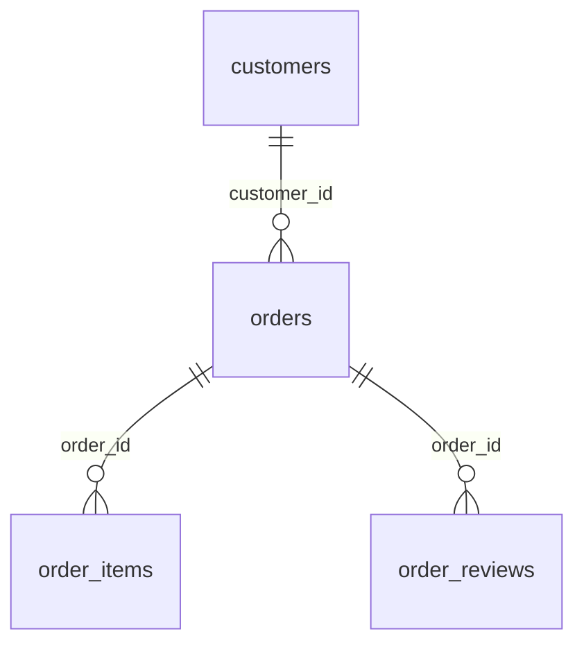

# Warehouse contract

All objects live in the dedicated `delivery_insights` schema.

| Object | Grain and key | Contract |
|---|---|---|
| customers | One customer ID; PK customer_id | Valid Brazilian state; source ID format |
| orders | One order; PK order_id; FK customer_id | Status and purchase/actual/estimated timestamps |
| order_items | One item per order; PK order_id + order_item_id | Nonnegative NUMERIC(14,2) price and freight, source BRL |
| order_reviews | One source row; PK source_row; FK order_id | Score 1-5; review_id deliberately not unique |
| order_facts | Exactly one row per accepted order | Sum items and average reviews BEFORE joining |
| eligible | Delivered order with actual/estimated timestamps | Calendar-day delay; late = delay_days > 0 |
| regional_metrics | Customer state, minimum 100 eligible orders | Incident-volume rank, late rate, review mean |
| monthly_metrics | Purchase month | Late rate, change in percentage points, sufficient-volume flag |

## Refresh

Verify the pinned archive; validate parents before children; quarantine invalid rows with source-row numbers. Take a transaction advisory lock; refresh all four project tables using client CSV COPY. Enforce constraints and exact count/item/freight reconciliation before commit. SQL failure rolls back the refresh. Replay replaces the snapshot instead of appending.

Database refresh is atomic; report-file publication is not a multi-file transaction. On a failed run, old reports must not be treated as current. Check the successful `warehouse_run.json` timestamp and terminal exit status.

## Definitions

- Denominator: delivered orders with actual and promised timestamps, not all purchases.
- Late: actual calendar date after promised calendar date; same day is on time regardless of hour.
- Region: customer state, not carrier, seller or warehouse location. Geography does not establish responsibility.
- Month: purchase month. Recent months have limited follow-up in this historical snapshot; censoring can bias observed-delivery rates.
- Review mean: average source review scores within each order, then average across reviewed orders. Missing reviews excluded; coverage reported.
- Item value: prices excluding freight, not profit/refunds/net revenue.
- Regional ranks require at least 100 eligible orders. Low-volume months remain visible and flagged.
- Missing original fields not used in the warehouse, e.g. review comments, are counted without automatically rejecting records.
- Validation covers only the four required source tables, not the entire Olist collection.

Olist and collaborators: https://www.kaggle.com/datasets/olistbr/brazilian-ecommerce . Historical 2016-2018 sample; CC BY-NC-SA 4.0 as published by the provider. No patient data or current PEI operating data.
